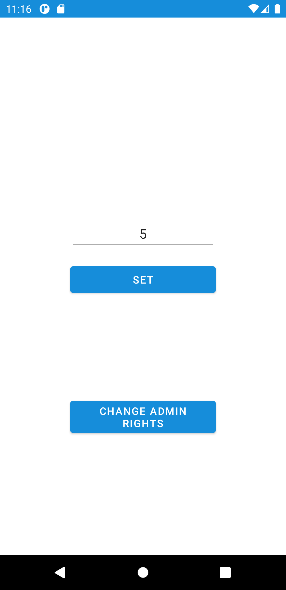
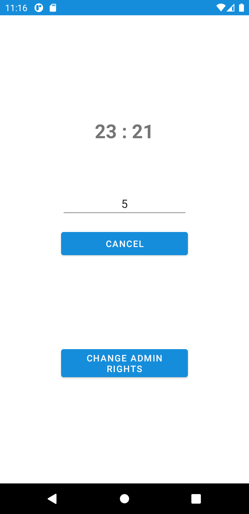

# Screen Timer

Sometimes, I use YouTube auto play to play random videos as a white noise. This application I made for my own use, turns off the screen after specified amount of minutes to prevent battery from draining. Admin rights should be given in order this application to function.

<p float="center">
	
	
</p>

## Features

- Give/remove admin rights
- Set timer
- Display the timeout time

## Build & Run

- Clone git repository:

	```sh
	git clone https://github.com/ermanergoz/screen-timer.git
	```

- Import the project into Android Studio:
	- Open Android Studio. After that Click on “Open an existing Android Studio project”. If Android Studio is already open, click on File and then Click on Open.
	- Select the location of the cloned repository and then Click OK.
	- After Gradle operations are finished, the application will be ready to run.

## Application Architecture & Dependencies

- [MVVM architecture](https://developer.android.com/jetpack/guide)
- [Data binding](https://developer.android.com/topic/libraries/data-binding)
- [Lifecycle](https://developer.android.com/topic/libraries/architecture/lifecycle)
- [Koin](https://insert-koin.io/)

## Meta

Yusuf Erman ERGÖZ – erman.ergoz@gmail.com

Distributed under the MIT license. See ``LICENSE`` for more information.

[https://github.com/ermanergoz](https://github.com/ermanergoz)

## Acknowledgements

- [Flaticon](https://www.flaticon.com/)

<!--
## Contributing

1. Fork it (<https://github.com/yourname/yourproject/fork>)
2. Create your feature branch (`git checkout -b feature/fooBar`)
3. Commit your changes (`git commit -am 'Add some fooBar'`)
4. Push to the branch (`git push origin feature/fooBar`)
5. Create a new Pull Request
-->
